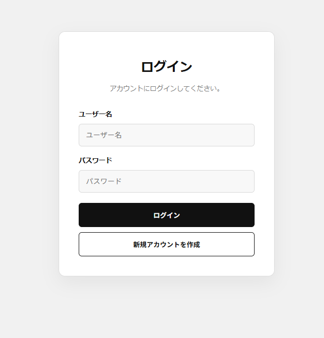
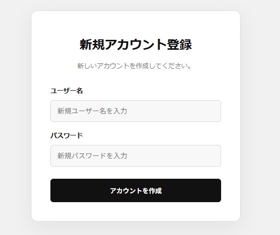
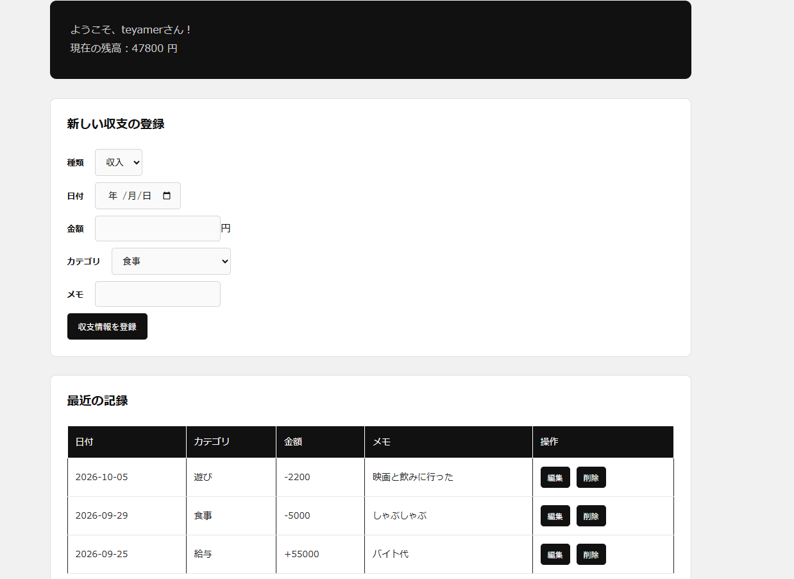

# money-management-app（お金管理アプリ）

## 概要

大学生向けのお金管理アプリです。日々の収入と支出を記録し、現在の残高や過去の収支履歴を確認できます。

PHPとMySQLを使用し、ユーザーごとに収支情報を管理するWebアプリケーションを開発しました。

## 主な機能

- **ユーザー登録**：アプリを利用するユーザーの情報を登録
- **ログイン・ログアウト**：ユーザー認証とログイン状態の管理
- **収支登録**：収入・支出の種類、日付、金額、カテゴリ、メモを登録
- **残高表示**：収入の合計から支出の合計を差し引いて残高を計算
- **収支履歴の表示**：最近の10件を表示し、すべての履歴も確認可能
- **収支情報の編集**：登録済みの収支情報を編集
- **収支情報の削除**：不要になった収支情報を削除

## 使用技術

| 技術 | 用途 |
|---|---|
| HTML | ページの構造や入力フォームの作成 |
| CSS | レイアウトや画面デザインの作成 |
| PHP | ログイン処理、収支情報の登録・取得・更新・削除 |
| MySQL | ユーザー情報と収支情報の保存・管理 |
| PDO | PHPからMySQLへの接続とSQLの実行 |

## アプリ画面





## データベース設計

本アプリでは、ユーザー情報を管理する `money_login_data` と、収支情報を管理する `user_money_data` の2つのテーブルを使用します。

### 1. `money_login_data`（ユーザー情報テーブル）

ユーザー登録やログインに必要な情報を管理するテーブルです。

| カラム名 | データ型の例 | 役割 |
|---|---|---|
| `user_id` | INT | ユーザーを識別するID。主キー |
| `user_name` | VARCHAR(255) | ログインに使用するユーザー名 |
| `password` | VARCHAR(255) | パスワード、またはハッシュ化したパスワードを保存 |

※ 上記は想定する構成です。実際のテーブルに作成日時などのカラムがある場合は、それらも記載します。

### 2. `user_money_data`（収支情報テーブル）

ユーザーが登録した収入・支出の情報を保存するテーブルです。各レコードをユーザーIDと関連付けることで、ユーザーごとに収支情報を管理します。

| カラム名 | データ型の例 | 制約・役割 |
|---|---|---|
| `money_id` | INT | 主キー。AUTO_INCREMENTで収支レコードごとにIDを自動採番 |
| `user_id` | INT | 収支情報を登録したユーザーのID |
| `type` | VARCHAR(10) | 収支の種類。`収入` または `支出` |
| `date` | DATE | 収支が発生した日付 |
| `amount` | INT | 収入または支出の金額 |
| `category` | VARCHAR(255) | 収支のカテゴリ |
| `memo` | TEXT など | 収支に関する補足情報 |

※ データ型は一般的な例です。実際のCREATE TABLE文に記載した型を確認して調整してください。日時を管理するカラムを追加している場合は、そのカラムについても記載します。

#### カテゴリの例

- 食事
- 交通費
- 買い物
- 遊び
- 家賃・水道・光熱費等
- 給与
- その他

#### カラムの役割

- `money_id`：各収支情報を一意に識別し、編集・削除する際に利用します。
- `user_id`：収支情報の所有者を識別し、ほかのユーザーのデータと区別します。
- `type`：収入と支出を区別し、残高計算に利用します。
- `date`：収支が発生した日付を記録し、履歴を日付順に表示する際に利用します。
- `amount`：収入・支出の金額を記録します。
- `category`：食事や交通費など、支出や収入の用途を分類します。
- `memo`：カテゴリだけでは表現できない補足情報を記録します。

### 3. テーブル間の関係

`money_login_data` と `user_money_data` は、`user_id` を通じて関連付けます。

1人のユーザーが複数の収支情報を登録できるため、データの関係は **1対多（1:N）** です。

```text
money_login_data
----------------
user_id (PK)
user_name
password
       |
       | 1対多
       |
       v
user_money_data
---------------
money_id (PK)
user_id
type
date
amount
category
memo
```

`money_login_data.user_id` がユーザーを識別し、`user_money_data.user_id` が各収支情報の所有者を示します。

### 4. 残高の計算方法

現在の残高は、対象ユーザーの収入合計から支出合計を差し引いて計算します。

**残高 = 収入の合計 − 支出の合計**

SQLでは、収支の種類に応じて金額を集計します。

```sql
SELECT
    SUM(CASE WHEN type = '収入' THEN amount ELSE 0 END)
    - SUM(CASE WHEN type = '支出' THEN amount ELSE 0 END)
    AS balance
FROM user_money_data
WHERE user_id = :user_id;
```

`WHERE user_id = :user_id` によって対象ユーザーの収支情報だけを集計します。

### 5. 収支履歴の取得

収支履歴は、日付の降順で取得します。同じ日付に複数のレコードがある場合は、収支IDの降順で並べます。

最近の10件を取得するSQLの例です。

```sql
SELECT *
FROM user_money_data
WHERE user_id = :user_id
ORDER BY date DESC, money_id DESC
LIMIT 10;
```

すべての履歴を表示する場合は、`LIMIT 10` を省略します。

## 実行環境

- PHPが動作するWebサーバー
- MySQLデータベース
- Webブラウザ

## セットアップ

1. PHPとMySQLが利用できる環境を用意します。
2. アプリケーションのファイルをWebサーバーに配置します。
3. MySQLにデータベースを作成し、必要なテーブルを用意します。
4. PHPのデータベース接続設定を環境に合わせて変更します。
5. ブラウザからログイン画面を開き、アプリを利用します。

※ MySQLにおいてセキュリティの観点から、ソースコードのデータベース名およびパスワードはxxxxxxとしています。データベース名、接続情報などはご自身で設定してください。

## 今後の改善案

- 月別・カテゴリ別の収支集計
- グラフによる収支の可視化
- 入力内容のバリデーション強化
- パスワードの安全なハッシュ化
- 外部キー制約などによるデータ整合性の向上
- スマートフォンでの操作性の改善

## 目的

PHP、HTML、CSS、MySQLを用いたWebアプリケーション開発を通じて、データベース設計、SQLによるデータ操作、フォーム処理、CRUD機能の実装について学ぶことを目的としています。
